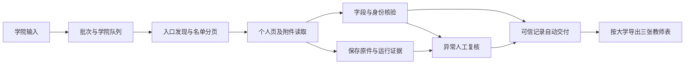

# 当前架构与模块

核对日期：2026-10-23。这里描述 OpenSource 根目录的工作台。旧 MyPlan 源码已删除，其 `server/agent_recon.py` 和类型注册流程不属于当前调用链；Mission B 是独立的名单链接核验工具，也不等同于教师资料采集器。

## 数据流

网页服务和定时入口由 [workbench.py](../workbench.py) 提供；[workbench_store.py](../workbench_store.py) 保存 SQLite 队列、复核决定与审计。[workbench_runner.py](../workbench_runner.py) 为学院启动独立采集进程，处理结束、失败和后续评估。具体并发数及资源预算以这些入口代码为准。

## 按问题找代码

| 职责 | 代码入口 |
| --- | --- |
| 输入解析、预览与批次 | [batch_input.py](../batch_input.py)、[workbench.py](../workbench.py) |
| 页面计划、采集编排与 API | [api_pilot.py](../api_pilot.py)、[deepseek_api.py](../deepseek_api.py) |
| HTTP 与浏览器获取 | [fynu_probe.py](../fynu_probe.py) 的 crawler／原件保存函数、[compatible_http.py](../compatible_http.py)、[browser_capture.py](../browser_capture.py)；[acquisition.py](../acquisition.py) 为早期获取方式对照 |
| 名单分类、目录行解释、表格、分页和姓名 | [faculty_navigation.py](../faculty_navigation.py)、[directory_rows.py](../directory_rows.py)、[roster_tables.py](../roster_tables.py)、[roster_sections.py](../roster_sections.py)、[person_names.py](../person_names.py) |
| 个人页结构与分段材料 | [profile_layouts.py](../profile_layouts.py)、[multi_profile_sections.py](../multi_profile_sections.py)、[grouped_roster.py](../grouped_roster.py) |
| 图片分类、OCR 与附件 | [image_triage.py](../image_triage.py)、[ocr_media.py](../ocr_media.py)、[image_profiles.py](../image_profiles.py) |
| 字段选择、评估和同人关联 | [quality_pipeline.py](../quality_pipeline.py)、[quality_fields.py](../quality_fields.py)、[roster_identity.py](../roster_identity.py)、[cross_college_identity.py](../cross_college_identity.py) |
| 列表教师与失效材料交付 | [roster_only_delivery.py](../roster_only_delivery.py)、[material_delivery.py](../material_delivery.py) |
| 去重、按大学分包及三表导出 | [identity_export.py](../identity_export.py)、[workbench_export.py](../workbench_export.py) |
| 断点、补采与既有材料复用 | [resume_acquisition.py](../resume_acquisition.py)、[resume_workbench.py](../resume_workbench.py) |
| 界面、批量复核与排序 | [workbench-static](../workbench-static/)；对应 API 在 workbench.py |

目录型名单在初采与续采中共用 `directory_rows.parse_directory`，统一保留姓名、链接、分组和嵌套行恢复依据，并维持原始条目处理顺序。续采重建不足时保留旧观察记录，在新运行的 `resume.json` 标明跳过原因；不改写旧运行材料。具体反例与验证范围见 [名单续采修复记录](maintenance/2026-10-23-directory-resume/README.md)。

## 当前工具分工

当前学院采集由 Crawlee／HTTPX 获取页面，BeautifulSoup 执行页面解析，DeepSeek API 参与有边界的结构理解与计划；需要渲染的页面通过 Playwright 调用浏览器补抓。规则执行、证据保存、字段校验、身份合并和交付由本地程序完成。当前 OCR 使用 RapidOCR，PDF 使用 pypdf 与 pypdfium2；安装版本以 [requirements.lock](../requirements.lock) 为准。

Crawl4AI 与 trafilatura 保留在早期对照、离线回放及共享依赖中，不能把最初对照报告直接当作今天的主采集调用链。根目录仍有 `fynu_probe.py`、`api_pilot.py` 等历史名称，其中被当前工作台调用的函数继续承担运行职责，不能仅凭文件名当作废弃试验删除。

页面先获取原始材料，再做名单、个人页、图片或 PDF 的相应处理。跨子站个人主页需要学校域与人员入口关联等依据；浏览器能打开网页不代表页面用途、人员身份和字段归属已确定。

DeepSeek Fetch、Jina、Firecrawl、Scrapy、Scrapling、ScrapeGraphAI、Stagehand 与 Docling 的对照或候选状态统一见 [试验索引](../experiments/README.md)。**Jina 仅保留测试配置与结果，不进入正式流程，不作为自动失败回退。** Docling 的本地试验环境与模型保留，目前主流程 OCR/PDF 仍走上述本地模块。

## 当前边界

- 已有网页监视、异常复核、人工输入、批次执行、定时／无界面入口、按大学导出和证据保存。
- 名单发现、特殊结构、动态网页、OCR 和同人合并仍需按样本验证；支持某个结构不构成全网兼容承诺。完整性口径见 [CONTEXT](../CONTEXT.md#完整性与采集维护职责)。
- 当前服务绑定本机地址并校验请求来源。公网或局域网多人访问、身份认证、权限分配、HTTPS、服务守护与外部通知还需部署工作；当前复核链接集中显示在工作台。
- 当前 Git 根目录是 OpenSource，远端为 `normaltank/NewPlan`。父级 MyPlan 的旧 Git 元数据为其他工作树保留；本项目选用技能时按 [Matt 工作流](agents/workflow.md) 核对来源。工作目录和运行数据路径没有迁移；上传源码不代表已经部署服务器。旧工作区清理范围见 [清除记录](maintenance/2026-10-21-retire-legacy/README.md)。
