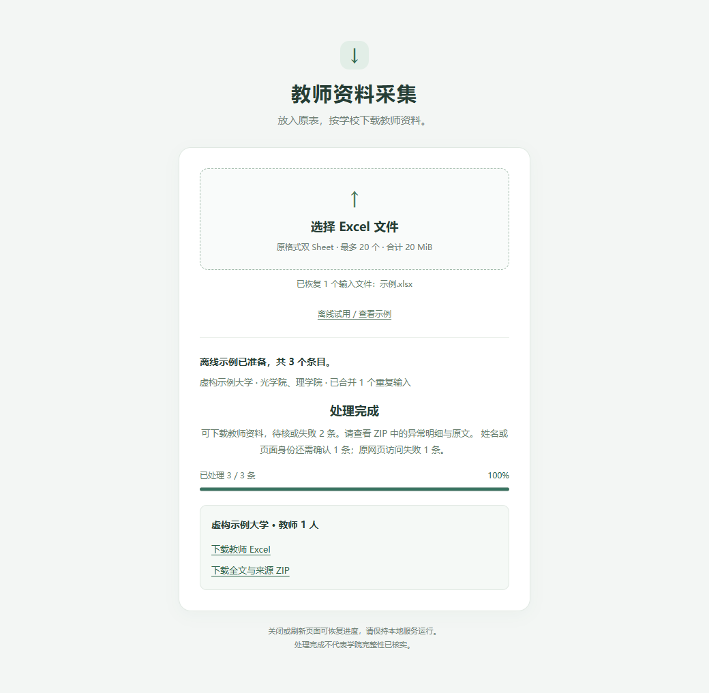

# Mission C 批次与简化分发交付

对应[规格 #43](https://github.com/normaltank/NewPlan/issues/43)、核心 #44、页面 #45、后台 #46，[PR #47](https://github.com/normaltank/NewPlan/pull/47)。当前使用见[简版说明](<../../../Mission C/使用说明.md>)、[页面维护](<../../../Mission C/WEB.md>)、[批次](<../../../Mission C/BATCH.md>)、[后台运行](<../../../Mission C/SERVER.md>)；本页保存当次证据。

## 范围与实际执行

沿用已确认的原格式 Excel→持久后台批次→中断续跑→大学 Excel/全文 ZIP 边界。最初三票分别实施，核心真实合入后才释放页面与后台依赖；用户后续要求简化分发页，作为 #45 的前端交付调整，共用已验收核心，无需重拆后台。默认 `/` 是参考 Mission B 精简版的输入/进度/输出单卡，原工作台保留 `/workbench`。只读参考 B，不沿用其凭据、发信和 EXE 范围。

实际角色、独立源提交和串行合入链见 [execution.json](execution.json)。各子代理均显式 gpt-6.1-sol/high/fork_turns=none；实施、集中修复、merger、Standards、Spec 分工真实执行。主代理负责调度、物理复制、最终浏览器验证及档案，不把这些记为子代理实施。

基线 aebe8d9；交付代码固定 **5b1a28ca866a67399f9d29ea3fc8caaf2afc2b86**，tree d2eab90594c85c83b3bdffe4c23cbb87d811154c。后续补档只新增本目录和档案索引；独立 Mission C 的69文件逐个 SHA256 与实际 D 目录相同。干净分发包的 SOURCE-MANIFEST 记录生成时 Git 提交和逐文件 hash。

## 反例与两轴结论

1636 整体 Standards 无阻塞，但 Spec 发现明确获奖新闻/维护公告误入教师表；首次集中修复后，7ad 复审又发现“正在维护/访问提示”类模板及历史公告分类不一致。第二轮按主内容的当前服务状态和访问中断判定，并保留独立个人身份，避免把研究/引用中的维护词当停服。原提取器、原姓名候选、全文和 HTML 保留，未为通过测试抹去旧错误。

- [最终 Standards](reviews/mission-c-v2-standards-final-5b1a28c.md)：阻塞0、新增非阻塞0；历史 P3 已修复，原 CLI 参数重复的判断性建议延后。
- [最终 Spec](reviews/mission-c-v2-spec-final-5b1a28c.md)：PASS，0发现。独立11条公开 CLI/cache/ZIP样本，3教师/8异常，11份HTML逐字相等；独立HTTP复验显式开始、示例重启绑定、策略拒绝及实际下载。
- 旧[1636 Spec](reviews/mission-c-v2-spec-1636ea9.md)、[7ad Spec](reviews/mission-c-v2-spec-qc-7ad0e16.md)和相应 Standards 保留当时失败事实，不改写为通过。

首页/新闻留疑似非个人，维护/验证留暂不可用，身份不足留待核；实际404/网络失败保留真实原因，有可靠教师身份才进主页失效表。所有输入仍可在批次/异常/原件核对；质量分类不证明任意网页身份或学院完整性。

## 精确验证与实际目录

在5b组合上，独立merger实际运行 delivery HTTP3项/21.786秒、简版真实Edge3项/44.487秒、原工作台demo Edge1项/16.442秒。暂停后服务重启、恢复到3/3，三条本机源各请求一次；实物下载三Sheet/十列、1教师/records3/异常2、全文与20个绑定hash核对通过。完整原工作台4项浏览器回归另有实施者证据。

1636 的84项全可选（含浏览器/OCR）回归331.060秒通过，是历史基线事实；未伪装成最终版本重跑。1636、7ad的Windows/Linux独立及根工作台CI均成功；最终补档提交的准确CI结果跟踪在[执行记录 #43](https://github.com/normaltank/NewPlan/issues/43)，不以配置存在代替通过。

实际 `D:/Agent Workspace/Intern/MyPlan/OpenSource/Mission C` 已用自己的虚拟环境启动并验证。原19份表在默认简版及维护页面导入为1180条、0问题、0处理/未排队，源hash不变；示例实际下载1教师/2异常，桌面/375px无横向溢出，浏览器无错误且应用请求全本机。额外headless worker一次退出0、23个已完成产物文件不变。其余53项未提交文件状态/hash在复制前后不变，包含Mission B。

[移动截图](mobile.png)。受控本地 `Mission C/outputs/v2-delivery-20261029/` 保存 verification.json、simple-verification.json、下载、截图及 audit-records；原19表、运行数据和缓存不进公开仓库或干净软件包。最终页面仅用虚构示例运行，未触发原表网站或收费请求。

## 偏差与限制

早期UI实施误给共享根开发环境新增 python-multipart0.0.20，已披露且没有盲目卸载；后续测试隔离，交付环境位于Mission C自己的.venv。它与53项源文件保护是两件事实。

实物验证脚本首次在页面初始化完成前强行选择禁用文件框，随后又遇到验证脚本的字符串求值被CSP拒绝；保存失败日志后改为等待可操作控件和URL条件，复用已完成批次继续验证，没有改产品或放宽CSP。一次复合后台启动命令被工具策略拒绝，改为直接运行受控本地服务成功；没有绕过未知进程保护。中断恢复按Git/产物/日志核对后续做，未重复真实采集。

复盘改进：依赖安装先核对解释器绝对路径与事务范围；浏览器验收等待公开控件就绪；长任务持久记录提交、日志与会话标识，避免大输出截断后盲目重跑。已有文件hash/路径边界复制守卫继续使用。本轮未新增真实采集、付费、密钥读取、远端部署、本机计划注册、PR合并或EXE；Windows/Linux程序与说明已交付，任意学院完整性仍未验证。
